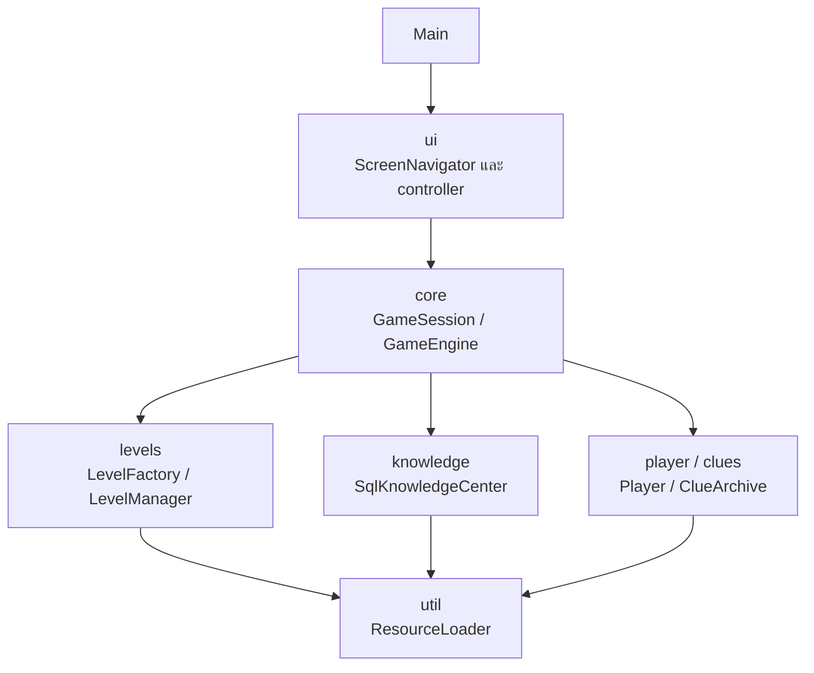
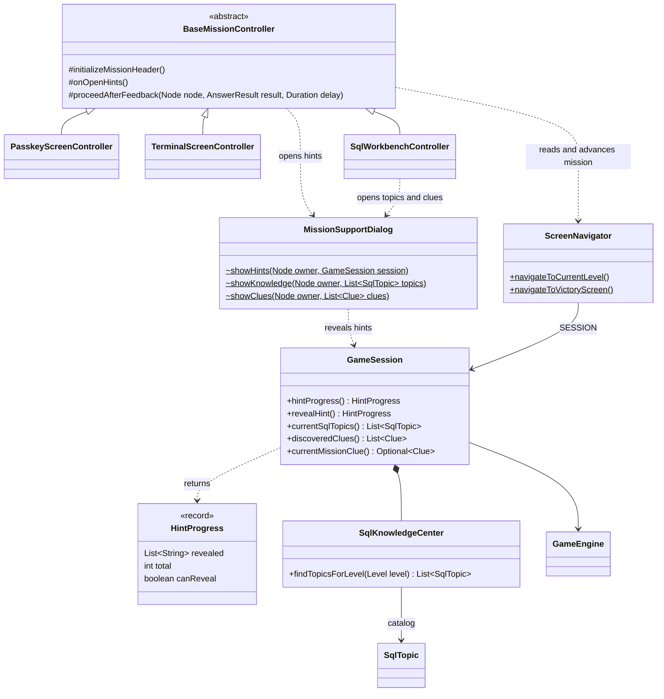
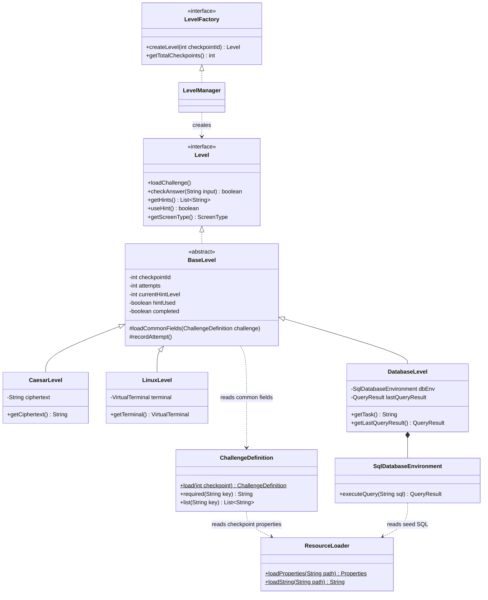
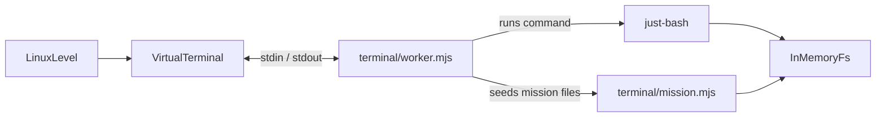
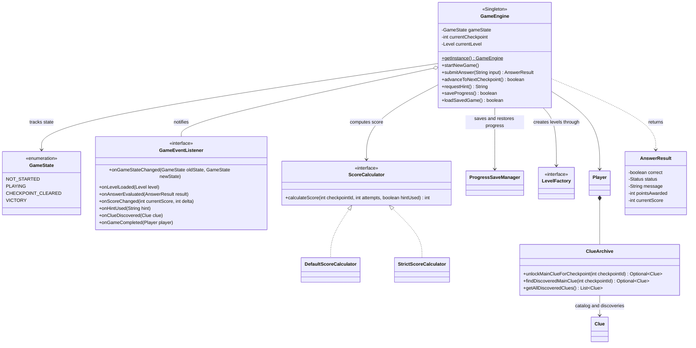

# CipherQuest — ต้นฉบับ Mermaid

อ่านเอกสารพร้อมภาพได้ที่ [Class Diagram](class-diagram.md) แก้แผนภาพที่ไฟล์นี้ แล้วสร้าง SVG ใหม่ในโฟลเดอร์ `docs/diagrams` ด้วย Mermaid CLI

```sh
mkdir -p target
mmdc -i docs/class-diagram-source.md -o target/class-diagram.md -a docs/diagrams -e svg -b white -c docs/diagrams/mermaid-config.json
```

## 1. ภาพรวมแพ็กเกจของ CipherQuest



## 2. คลาสหน้าด่านและระบบช่วยผู้เล่น



## 3. ลำดับชั้นของด่านและการโหลดข้อมูล



## 4. เส้นทางคำสั่งของ Linux Terminal



## 5. คลาส Game Engine และความคืบหน้า


