# CipherQuest — Class Diagram

แผนภาพแสดงคลาสและเมธอดหลักที่เกี่ยวกับการเปิดหน้าด่าน การเล่น และการบันทึกความคืบหน้า กดที่ภาพเพื่อเปิดขนาดเต็ม หรือเปิด [ต้นฉบับ Mermaid](class-diagram-source.md) เพื่อแก้ไขแผนภาพ

## 1. ภาพรวมแพ็กเกจ

## 2. หน้าด่าน คำใบ้ และความรู้ SQL

ผู้เล่นเปิดคำใบ้ได้ทีละขั้นจากหน้าด่าน `GameSession.revealHint()` เรียก `GameEngine.requestHint()` เมื่อยังเปิดเพิ่มได้ การเปิดคลังความรู้หรือคลังเบาะแสใช้ข้อมูลแบบอ่านอย่างเดียว ความรู้ SQL จะแสดงตามหัวข้อของด่าน ส่วนคลังเบาะแสแสดงรายการที่ผู้เล่นค้นพบแล้ว เมื่อผ่านด่าน `BaseMissionController` แสดงคะแนนและเบาะแสก่อนส่งให้ `ScreenNavigator` ไปหน้าถัดไป

## 3. โครงสร้างด่านและการโหลดข้อมูล

`LevelManager` สร้าง `CaesarLevel` สำหรับด่าน 1, `LinuxLevel` สำหรับด่าน 2 และ `DatabaseLevel` สำหรับด่าน 3–7 แต่ละด่านตรวจคำตอบผ่านสัญญา `Level` และใช้สถานะร่วมจาก `BaseLevel` ส่วน `SqlKnowledgeCenter` กับ `ClueArchive` ใช้ `ResourceLoader` อ่านไฟล์ `.properties` ด้วย UTF-8 เช่นเดียวกับข้อมูลโจทย์

## 4. Linux Terminal

`VirtualTerminal` เริ่ม Node.js worker เมื่อได้รับคำสั่งแรก และปิด worker เมื่อออกจากด่านหรือรีเซ็ต ระหว่างเล่น just-bash รันคำสั่งบนระบบไฟล์เสมือนและส่งผลกลับให้ `LinuxLevel` ตรวจความสำเร็จของภารกิจ

## 5. Game Engine และความคืบหน้า

หลังตรวจคำตอบถูก `GameEngine` คำนวณคะแนน ปลดล็อกด่านถัดไปและเบาะแสตามภารกิจ แล้วบันทึกความคืบหน้า เมื่อสถานะเปลี่ยนเป็น `VICTORY` ในด่านสุดท้าย `ScreenNavigator` เปิดหน้าสรุปผลที่ `VictoryScreenController` อ่านสถิติจาก `GameEngine`

## 6. รูปแบบที่ใช้ในโค้ด

| รูปแบบ | คลาส | หน้าที่ |
|---|---|---|
| Singleton | `GameEngine` | ให้ส่วนต่าง ๆ ของแอปใช้สถานะเกมชุดเดียวกัน |
| Factory | `LevelFactory` และ `LevelManager` | สร้างด่านตามหมายเลข checkpoint |
| Strategy | `ScoreCalculator` | กำหนดวิธีคิดคะแนน โดยค่าเริ่มต้นใช้ `DefaultScoreCalculator` |
| Observer | `GameEventListener` | รับการแจ้งเตือนเมื่อสถานะเกมหรือผลการเล่นเปลี่ยน |
| Adapter | `VirtualTerminal` | รับส่งคำสั่งและผลลัพธ์ระหว่าง Java กับ Node.js worker |
| Facade | `GameSession` | ให้หน้าจอเรียกคำสั่งเกมและอ่านข้อมูลสำหรับแสดงผลผ่าน API เดียว |
