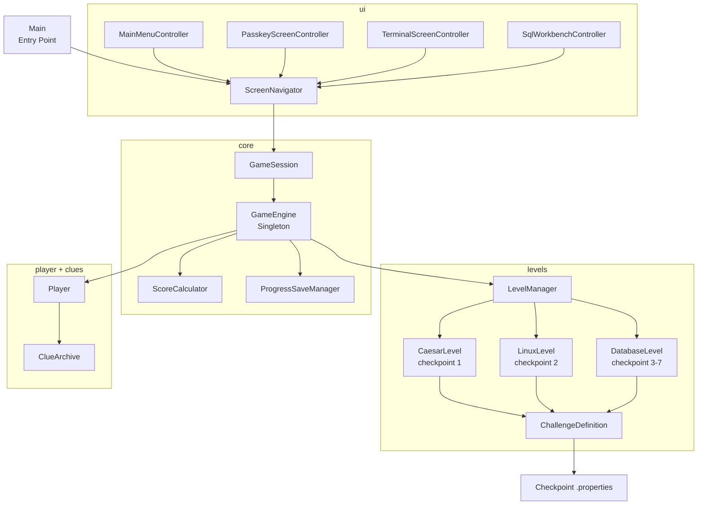
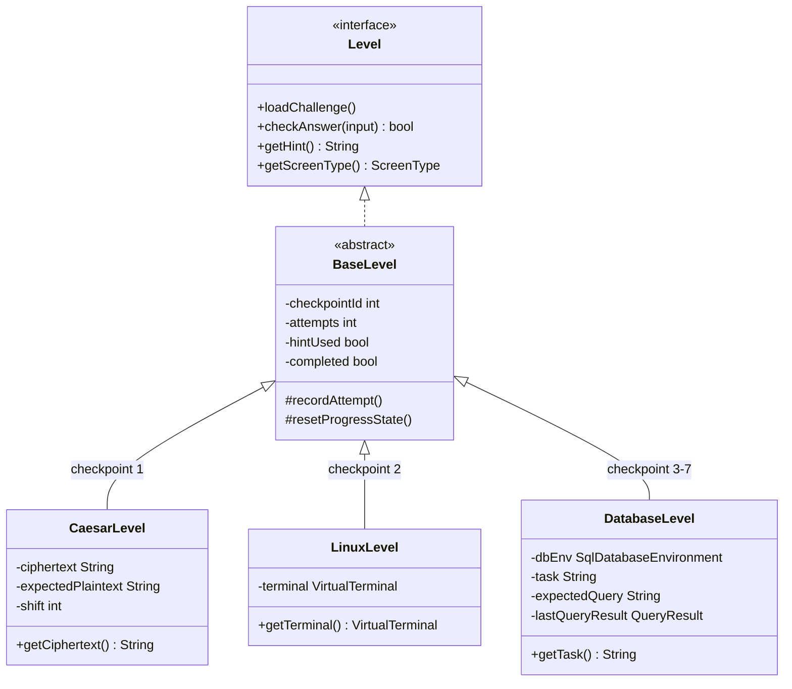
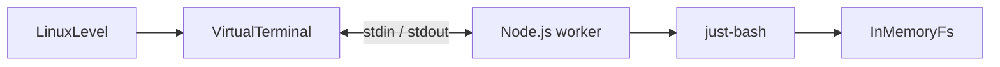
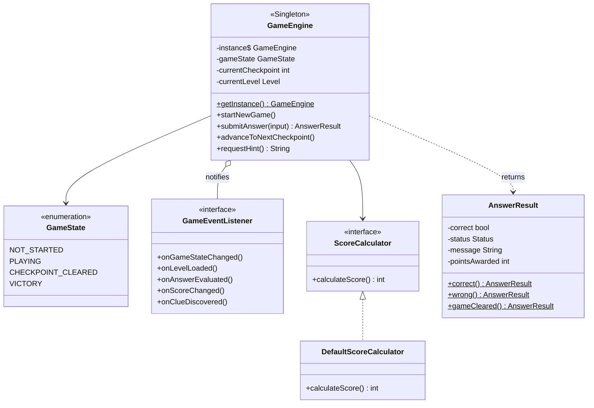

# CipherQuest — Class Diagram

## 1. ภาพรวมระบบ (Package Overview)

---

## 2. Level Hierarchy — Template Method Pattern

---

## 3. Linux Terminal

`LinuxLevel` ใช้ `VirtualTerminal` จัดการ Node.js worker หนึ่งตัวต่อด่าน คำสั่งและไฟล์ของผู้เล่นอยู่ใน session ของ just-bash ส่วน Java ใช้ผลการรันโปรแกรมภารกิจเพื่อประเมินว่าผ่านด่านหรือยัง

---

## 4. Game Engine — Singleton + Observer + State Machine

---

## 5. Design Patterns สรุป

| Pattern | Classes | สั้นๆ |
|---|---|---|
| **Singleton** | `GameEngine` | มี instance เดียวตลอด |
| **Template Method** | `BaseLevel` → 3 subclasses | base กำหนด skeleton, subclass override เฉพาะส่วนต่าง |
| **Adapter** | `VirtualTerminal` | เชื่อม Java กับ shell session ของ just-bash |
| **Strategy** | `ScoreCalculator` | สลับ algorithm คะแนนได้ไม่แตะ Engine |
| **Observer** | `GameEventListener` | Engine ยิง event ไปทุก listener เมื่อ state เปลี่ยน |
| **Factory Method** | `LevelManager.createLevel()` | สร้าง Level subclass ถูกตัวตาม checkpoint id |
| **Facade** | `ScreenNavigator` | ซ่อน FXML/CSS boilerplate ทั้งหมด |
| **Value Object** | `AnswerResult`, `QueryResult`, `Clue` | Immutable + named factory methods |
